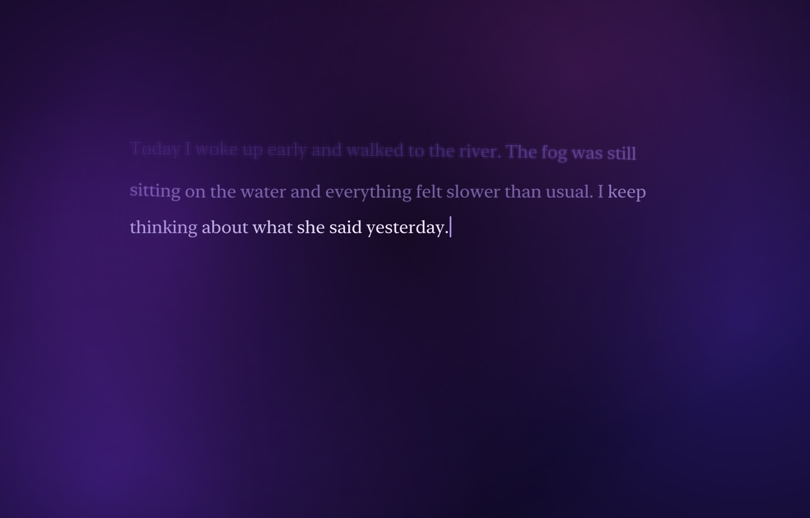
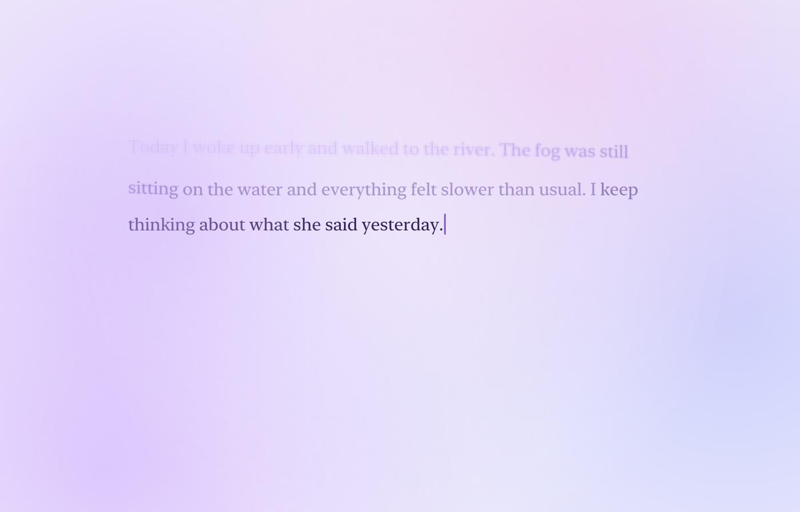
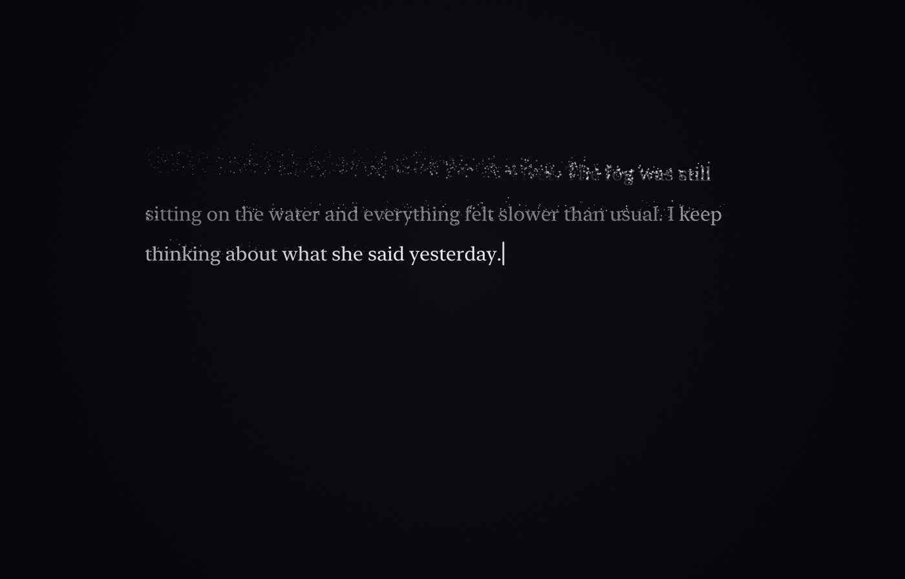
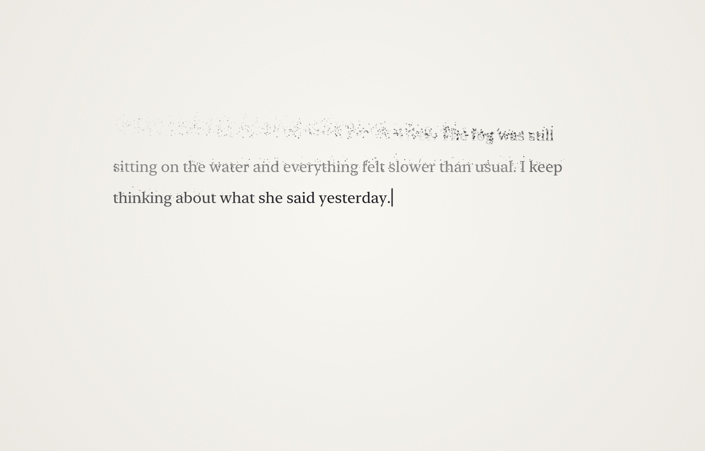

<div align="center">
  
  <h1>Void Journal</h1>
  <p><strong>Write it down. Let it go.</strong></p>
  <p>A native macOS journal where your words disappear as you write.<br>Nothing is ever saved.</p>
  <p>
    <a href="https://github.com/PatrikTrefil/void-journal/actions/workflows/ci.yml"></a>
    
    
  </p>
  <p><a href="https://github.com/PatrikTrefil/void-journal/releases/latest"><strong>Download for macOS</strong></a> · <a href="#build-it-yourself">Build it yourself</a> · <a href="#releasing">Release guide</a></p>
</div>

<picture>
  <source media="(prefers-color-scheme: dark)" srcset="docs/screenshots/void-dark.jpg">
  <source media="(prefers-color-scheme: light)" srcset="docs/screenshots/void-light.jpg">
  
</picture>

## A journal for letting go

Your newest thought stays on screen. Older words fade away at a pace that follows your
typing. Pause for a moment and your current sentence stays with you. Press **⌘↩** when
you're ready to let everything go.

- **Two themes.** Void fades words into drifting violet gradients. Dissolve breaks letters
  into particles that float away.
- **Light or dark.** Follow your Mac's appearance or choose your own in Settings.
- **Room to write.** Full screen, four text sizes, and window controls that fade while you type.
- **Forward only.** Edit recent text with Backspace, or paste something you want to release.
- **No journal files.** Your writing lives in memory and disappears when you close the app.
  Only your preferences are saved.

The first launch walks you through the idea by writing and releasing a few sentences.
Replay it anytime from **Help ▸ Show Introduction**.

## Pick your atmosphere

<table>
  <tr>
    <th>Void · dark</th>
    <th>Void · light</th>
  </tr>
  <tr>
    <td></td>
    <td></td>
  </tr>
  <tr>
    <th>Dissolve · dark</th>
    <th>Dissolve · light</th>
  </tr>
  <tr>
    <td></td>
    <td></td>
  </tr>
</table>

<sub>Rendered from the app with sample text. Both themes respect Reduce Motion.</sub>

## Get the app

Requires **macOS 14 or later**. The release download runs on **Apple silicon and Intel** Macs.

1. Download the ZIP from [GitHub Releases](https://github.com/PatrikTrefil/void-journal/releases/latest).
2. Unzip it and drag **Void Journal.app** to **Applications**.
3. Open the app and start writing.

> The downloadable app is ad hoc signed and is not notarized by Apple. If macOS blocks it,
> try opening it once, then use **System Settings ▸ Privacy & Security ▸ Open Anyway**
> if you trust the download. You can also build from source below.

## Build it yourself

Install the Xcode Command Line Tools if you don't already have a Swift toolchain:

```bash
xcode-select --install
```

Then, from this repository:

```bash
make run
```

This builds and opens `build/Void Journal.app`. Xcode itself isn't required.

| Command | What it does |
| --- | --- |
| `make app` | Build a release app for your Mac |
| `make debug` | Build a debug app |
| `make run` | Build and open the app |
| `make install` | Build and copy the app to `/Applications` |
| `make reset-intro` | Show the introduction on next launch |
| `make screenshots` | Refresh the four README screenshots using sample text |
| `make release VERSION=v1.0.0` | Build a universal release ZIP and SHA-256 checksum locally |
| `make format` | Format Swift sources |
| `make lint` | Check Swift formatting and style |
| `make clean` | Remove build output |

To compile without bundling the app, run `swift build`. Formatting uses `swift format`,
which ships with recent Swift toolchains. Run `make format` before committing and keep
`make lint` clean. Rules live in [`.swift-format`](.swift-format).

## Releasing

GitHub Actions checks formatting and builds a universal release archive on pull requests
and pushes to `main`. To publish a release, push a version tag on the commit you want to ship
after those checks pass:

```bash
git tag -a v1.0.0 -m "Void Journal 1.0.0"
git push origin v1.0.0
```

The [release workflow](.github/workflows/release.yml) accepts tags in `vMAJOR.MINOR.PATCH`
format, builds both architectures, sets the app version from the tag, verifies its ad hoc
signature, and publishes a GitHub Release with generated notes, a ZIP, and its SHA-256 checksum.
It uses GitHub's built-in `GITHUB_TOKEN`; no personal access token or signing secrets are needed.
The first release makes the download link above available.

To check a downloaded archive, put the ZIP and its `.sha256` file in the same directory and run:

```bash
shasum -a 256 -c Void-Journal-v1.0.0-macOS-universal.zip.sha256
```

Apple Developer ID signing and notarization aren't configured. They require an Apple
Developer account and credentials before the workflow can produce notarized downloads.

<details>
<summary>Inside the project</summary>

```text
Sources/VoidJournal/
  App/        App entry point, menus, preferences
  Engine/     Text model, word wrapping, release pacing
  Rendering/  Text, particles, fades, palettes
  Views/      Writing window, backgrounds, intro, settings
  Debug/      Offscreen screenshot rendering
scripts/      App bundling, release packaging, screenshots, icon generation
Resources/    Info.plist and app icon
```

See [CLAUDE.md](CLAUDE.md) for the product spec and architecture notes.

</details>
