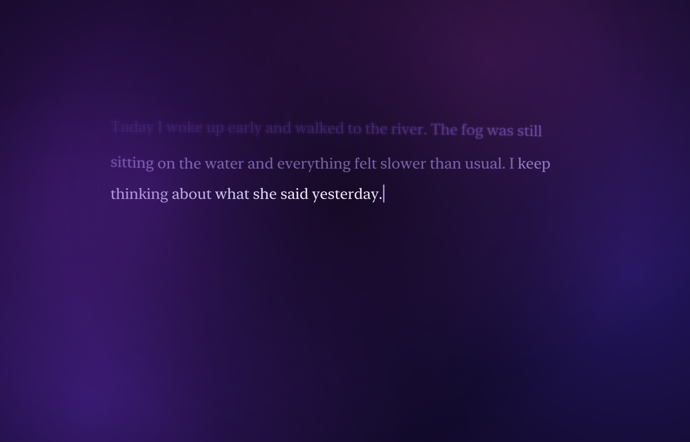
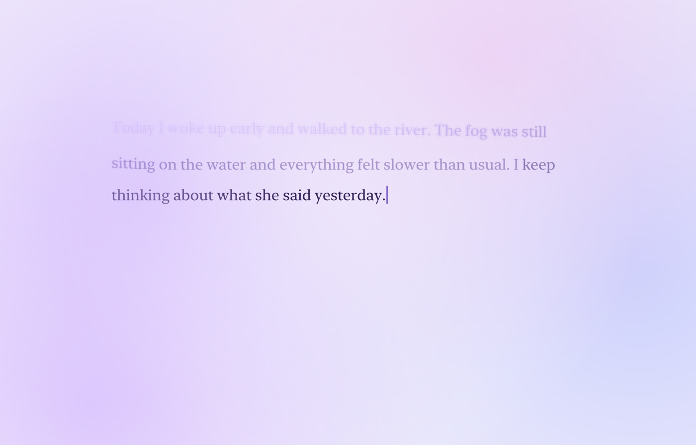
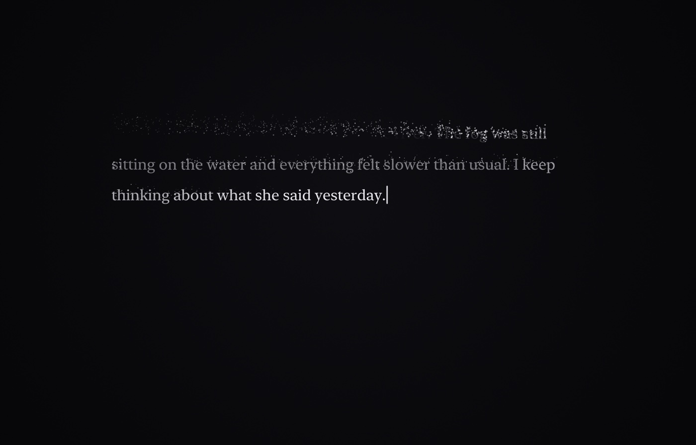
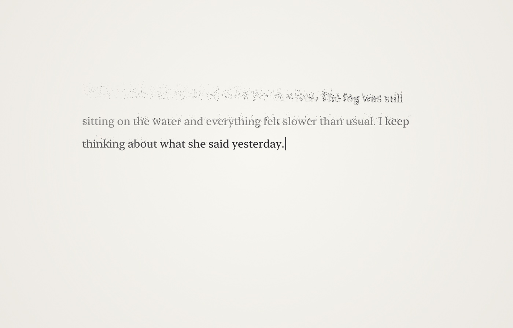

<div align="center">
  
  <h1>Void Journal</h1>
  <p><strong>Write it down. Let it go.</strong></p>
  <p>A native macOS and Windows journal where your words disappear as you write.<br>Nothing is ever saved.</p>
  <p>
    <a href="https://github.com/PatrikTrefil/void-journal/actions/workflows/ci.yml"></a>
    
    
    
    
  </p>
  <p><a href="https://github.com/PatrikTrefil/void-journal/releases/latest"><strong>Download for macOS or Windows</strong></a> · <a href="#build-it-yourself">Build it yourself</a> · <a href="#releasing">Release guide</a></p>
</div>

<picture>
  <source media="(prefers-color-scheme: dark)" srcset="docs/screenshots/void-dark.jpg">
  <source media="(prefers-color-scheme: light)" srcset="docs/screenshots/void-light.jpg">
  
</picture>

## A journal for letting go

Your newest thought stays on screen. Older words fade away at a pace that follows your
typing. Pause for a moment and your current sentence stays with you. Press **⌘↩** when
you're ready to let everything go (**Ctrl+Enter** on Windows).

- **Two themes.** Void fades words into drifting violet gradients. Dissolve breaks letters
  into particles that float away.
- **Light or dark.** Follow your system's appearance or choose your own in Settings.
- **Room to write.** Full screen, four text sizes, and window controls that fade while you type.
- **Forward only.** Edit recent text with Backspace, or paste something you want to release.
- **No journal files.** Your writing lives in memory and disappears when you close the app.
  Only your preferences are saved.

The first launch walks you through the idea by writing and releasing a few sentences.
Replay it anytime from **Help ▸ Show Introduction**. Screenshots below show the Mac app.

## Pick your atmosphere

<table>
  <tr>
    <th>Void · dark</th>
    <th>Void · light</th>
  </tr>
  <tr>
    <td></td>
    <td></td>
  </tr>
  <tr>
    <th>Dissolve · dark</th>
    <th>Dissolve · light</th>
  </tr>
  <tr>
    <td></td>
    <td></td>
  </tr>
</table>

<sub>Rendered from the app with sample text. Both themes respect Reduce Motion.</sub>

## Get the app

**macOS:** requires **macOS 14 or later**. The universal download runs on **Apple silicon and Intel** Macs.

1. Download the ZIP from [GitHub Releases](https://github.com/PatrikTrefil/void-journal/releases/latest).
2. Unzip it and drag **Void Journal.app** to **Applications**.
3. Open the app and start writing.

> The downloadable app is ad hoc signed and is not notarized by Apple. If macOS blocks it,
> try opening it once, then use **System Settings ▸ Privacy & Security ▸ Open Anyway**
> if you trust the download. You can also build from source below.

**Windows:** requires **Windows 10 22H2 or Windows 11**. Download the `Windows-x64-Setup.exe`
installer for Intel/AMD PCs or `Windows-arm64-Setup.exe` for Windows on Arm. Setup installs
for your user without administrator rights, adds a Start menu shortcut, and supports
uninstalling from Windows Settings. A desktop shortcut is optional.
Portable ZIPs are also available: extract one and open **VoidJournal.exe**.
Both options include the .NET runtime. The app and installer are unsigned, so
Windows SmartScreen may show a warning on first launch.

Windows uses native WPF controls and the Fluent theme, with standard title-bar controls,
keyboard menus, system appearance, high contrast, and Windows animation preferences.
Use **Ctrl+Enter** to release everything, **Ctrl+,** for Settings, **F11** for full screen,
**Ctrl+1/2** for themes, and **Ctrl++/−/0** for text size. Only settings are written to
`%LOCALAPPDATA%\VoidJournal\preferences.json`.

## Build it yourself

For macOS, install the Xcode Command Line Tools if you don't already have a Swift toolchain:

```bash
xcode-select --install
```

Then, from this repository:

```bash
cd macos
make run
```

This builds and opens `macos/build/Void Journal.app`. Xcode itself isn't required.
Run the following commands inside `macos/`.

| Command | What it does |
| --- | --- |
| `make app` | Build a release app for your Mac |
| `make debug` | Build a debug app |
| `make run` | Build and open the app |
| `make install` | Build and copy the app to `/Applications` |
| `make reset-intro` | Show the introduction on next launch |
| `make screenshots` | Refresh the four README screenshots using sample text |
| `make release VERSION=v1.0.0` | Build a universal release ZIP and SHA-256 checksum locally |
| `make format` | Format Swift sources |
| `make lint` | Check Swift formatting and style |
| `make clean` | Remove build output |

To compile without bundling the app, run `swift build`. Formatting uses `swift format`,
which ships with recent Swift toolchains. Run `make format` before committing and keep
`make lint` clean. Rules live in [`macos/.swift-format`](macos/.swift-format).

For Windows, install the **.NET 10 SDK**, then run these commands from the repository root:

```powershell
dotnet run --project windows/VoidJournal
dotnet run --project windows/VoidJournal.Tests -c Release
./windows/scripts/package-release.ps1 -Tag v1.0.0 -Runtime win-x64
# Include a Windows installer as well:
./windows/scripts/package-release.ps1 -Tag v1.0.0 -Runtime win-x64 -Installer
```

The app uses C# and WPF; no Visual Studio or Windows App SDK workload is required.
The engine checks cover Unicode graphemes, retention, aging, release, and deletion limits.
Use `-Runtime win-arm64` to package for Windows on Arm. ZIPs and checksums appear in
`windows/build/`. `-Installer` downloads a pinned, SHA-256-verified Inno Setup compiler
into `windows/build/tools/` and builds a per-user setup EXE. To check install/uninstall,
run `./windows/scripts/test-installer.ps1 -InstallerPath <setup.exe>` on a test machine.
WPF's Fluent theme API is currently marked experimental by .NET;
the project explicitly opts into that API.

## Releasing

GitHub Actions checks Swift formatting, builds the universal Mac archive, runs the Windows
engine checks, and packages Windows x64 and ARM64 ZIPs and installers on pull requests
and pushes to `main`. The x64 job also tests installing and uninstalling the app.
To publish a release, push a version tag on the commit you want to ship
after those checks pass:

```bash
git tag -a v1.0.0 -m "Void Journal 1.0.0"
git push origin v1.0.0
```

The [release workflow](.github/workflows/release.yml) accepts tags in `vMAJOR.MINOR.PATCH`
format, sets both app versions from the tag, verifies the Mac ad hoc signature,
and waits for all platform builds before publishing a single GitHub Release with generated
notes, three ZIPs (macOS universal, Windows x64, Windows ARM64), two Windows setup EXEs
(x64 and ARM64), and a SHA-256 checksum for each of those five downloads.
It uses GitHub's built-in `GITHUB_TOKEN`; no personal access token or signing secrets are needed.
The first release makes the download link above available.

To check a downloaded archive, put the ZIP and its `.sha256` file in the same directory and run:

```bash
shasum -a 256 -c Void-Journal-v1.0.0-macOS-universal.zip.sha256
```

Apple Developer ID signing, notarization, and Windows Authenticode signing aren't configured.
They require signing credentials before the workflow can produce signed Windows or
notarized Mac downloads.

<details>
<summary>Inside the project</summary>

```text
macos/Sources/VoidJournal/
  App/        App entry point, menus, preferences
  Engine/     Text model, word wrapping, release pacing
  Rendering/  Text, particles, fades, palettes
  Views/      Writing window, backgrounds, intro, settings
  Debug/      Offscreen screenshot rendering
macos/scripts/      App bundling, release packaging, screenshots, icon generation
macos/Resources/    Info.plist and app icon
windows/VoidJournal/       Native WPF app, drawing surface, input, settings, intro
windows/VoidJournal.Core/  In-memory journal model and pacing
windows/VoidJournal.Tests/ Dependency-free engine checks
windows/scripts/          Self-contained Windows release packaging
windows/installer/        Per-user Windows installer definition
```

See [CLAUDE.md](CLAUDE.md) for the product spec and architecture notes.

</details>
